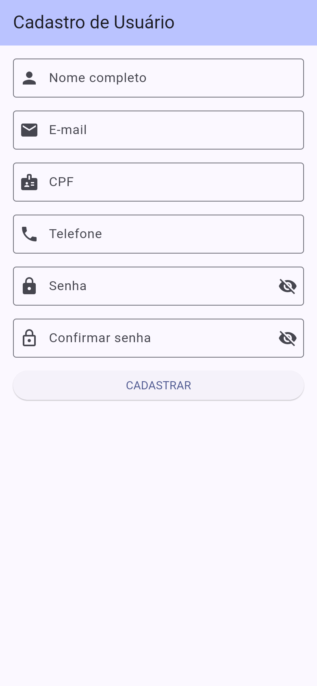
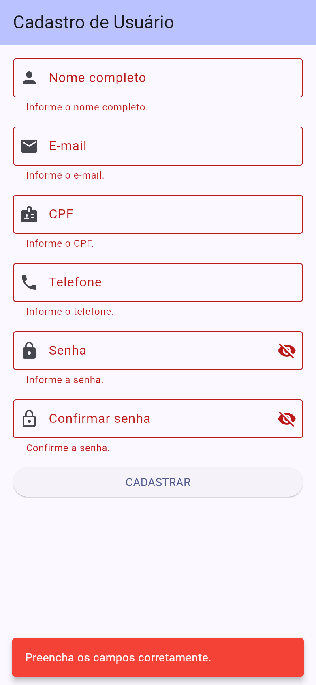
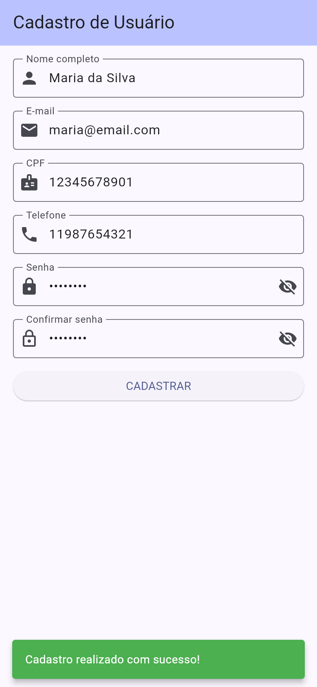

# Cadastro de Usuário

Atividade de Flutter: uma tela de cadastro de usuário. O formulário segue o padrão visto em aula — `TextFormField` dentro de um `Form` com `GlobalKey<FormState>`, validador em cada campo, `keyboardType`, `inputFormatters` e feedback com `SnackBar` via `ScaffoldMessenger.of(context).showSnackBar`.

Todo o texto da interface e as mensagens de erro estão em português do Brasil.

## Funcionalidades

### Obrigatórias

- Campos obrigatórios: nome completo, e-mail (precisa conter `@`), CPF (somente dígitos, 11 posições), telefone (somente dígitos, 10 ou 11 posições) e senha (mínimo de 6 caracteres).
- Cada campo usa o `keyboardType` adequado. CPF e telefone usam `FilteringTextInputFormatter.digitsOnly` e `LengthLimitingTextInputFormatter`.
- O texto fica em `TextEditingController`, descartados no `dispose`.
- O validador de cada campo mostra o erro logo abaixo do campo inválido.
- O botão **CADASTRAR** chama `_formKey.currentState!.validate()`. Com tudo válido, aparece a `SnackBar` verde **Cadastro realizado com sucesso!**.
- Hierarquia: `Scaffold` > `Form` > `SingleChildScrollView` > `Column`, com `InputDecoration` (`labelText`, `hintText`, `prefixIcon` e `OutlineInputBorder`), espaçamento de 16 px entre os campos e padding no conteúdo rolável.

### Desafio extra

- Campo **Confirmar senha**, que só passa se for igual à senha.
- Botão de mostrar/ocultar senha (`suffixIcon`) nos dois campos de senha.
- Validação de e-mail com `RegExp`, aplicada depois da checagem do `@`.
- `SnackBar` vermelha quando **CADASTRAR** é pressionado com algum campo inválido.

## Como executar

Na raiz do projeto:

```bash
flutter pub get
flutter run
```

Na web:

```bash
flutter run -d chrome
```

Para conferir a análise e os testes de widget:

```bash
flutter analyze
flutter test
```

## Capturas de tela

Imagens do app em Flutter web, em um viewport de celular (390×844).

### Formulário vazio



### Cadastro vazio: erros nos campos e SnackBar vermelha



### Dados válidos e SnackBar verde de sucesso


